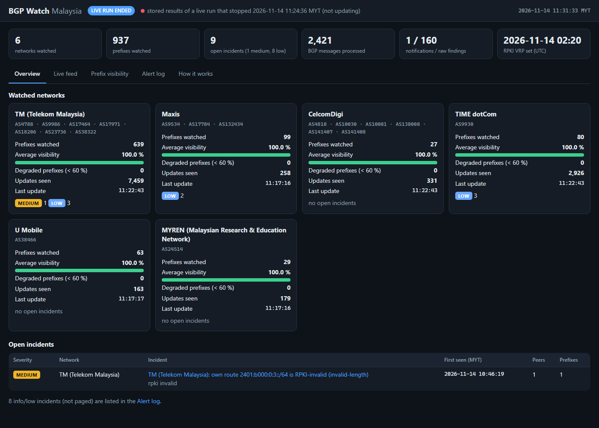
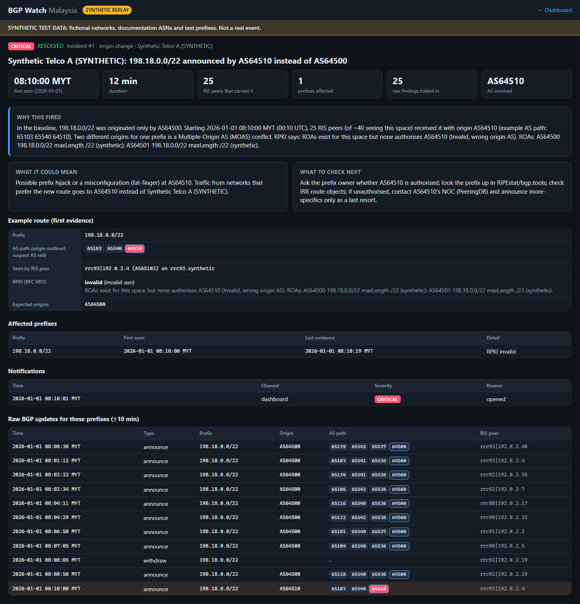
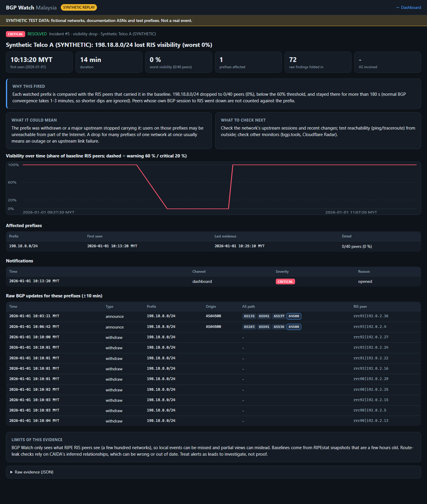
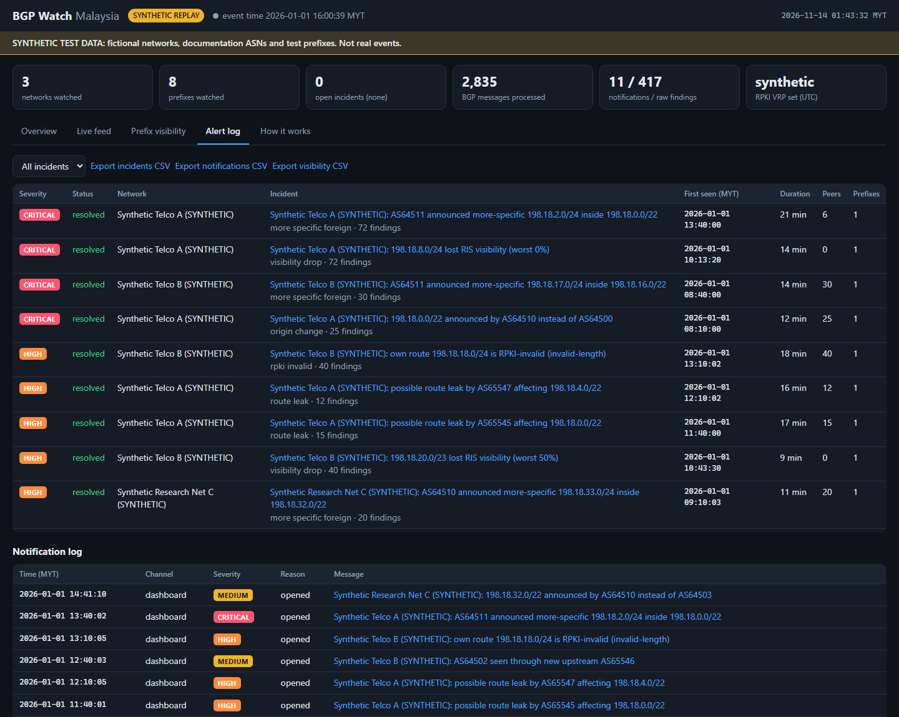
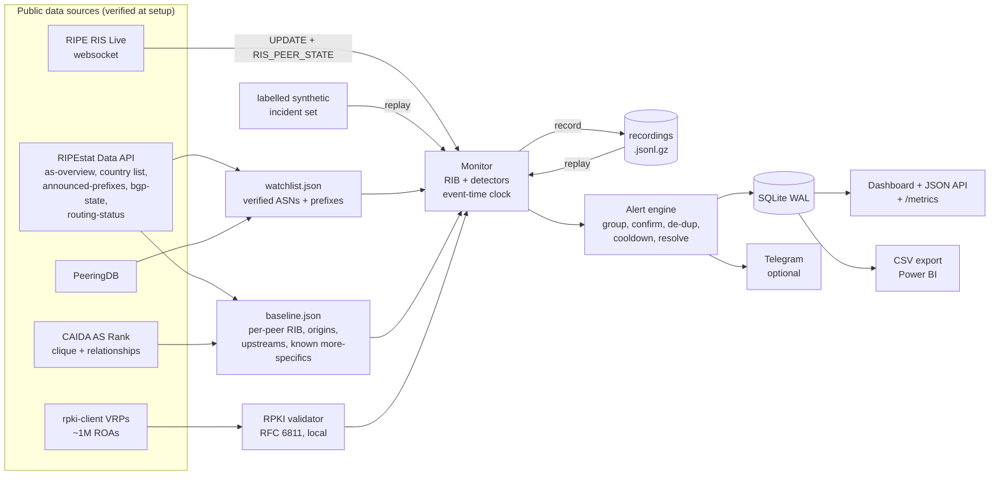

# BGP Watch Malaysia

**Live BGP monitoring for Malaysian networks.** BGP Watch streams real-time BGP updates from
the **RIPE NCC RIS Live** route collectors for the address space of **TM, Maxis, CelcomDigi,
TIME dotCom, U Mobile and MYREN**. It detects **prefix hijacks (origin change / MOAS and
sub-prefix), RPKI-invalid routes, visibility loss (outages) and likely route leaks**, and
explains each alert in plain English on a local NOC-style dashboard.

It runs on a normal Windows laptop with plain Python: no VM, no Docker, no API keys.



| Incident page: why it fired (synthetic hijack) | Outage with visibility chart (synthetic) | Alert log (synthetic demo set) |
|---|---|---|
|  |  |  |

---

## What it detects

| Detector | Fires when | Why it matters |
|---|---|---|
| **Origin change / MOAS** | A watched prefix is announced by an AS that never originated it in the baseline | Classic prefix hijack or fat-finger. Traffic goes to the wrong network |
| **More-specific (sub-prefix)** | A more-specific of watched space is announced by an unexpected AS | BGP prefers the most specific route, so this captures traffic even where the real route is still visible. The most dangerous hijack type |
| **RPKI invalid** | The network's *own* route fails RFC 6811 origin validation (wrong AS or longer than the ROA's maxLength) | Networks that enforce ROV drop it, so the prefix goes dark for part of the Internet |
| **Visibility drop** | Fewer RIS peers carry a prefix than in the baseline (below 60 % = high, below 20 % = critical) for longer than normal convergence (180 s) | Outage, withdrawal or upstream failure |
| **Route leak (heuristic)** | A *valley* in the AS path: a non-clique AS between two transit-free clique ASes, or the origin's own customer acting as its upstream | Traffic detours through a network that should not carry it |
| **New upstream** | The origin is reached through an AS that is in neither the baseline nor CAIDA's inferred relationships (including a RIS peer suddenly claiming a direct link) | New transit (often planned), a leak, or a forged-origin hijack |
| **Unexpected origination** | A *watched* Malaysian ASN originates a prefix outside its known space that RPKI says belongs to someone else | The reverse view: the Malaysian network may be the one hijacking (a fat-fingered static route) |

Every alert shows its evidence: the AS path with the suspect AS highlighted, the RPKI verdict
and the exact ROAs behind it, how many RIS peers saw it, a timeline of raw updates and, for
outages, a visibility chart.

### Alerting that does not spam

- **One incident per event.** Findings are grouped per network and suspect AS, so a hijacker
  announcing 50 prefixes, or an outage hitting 300, is *one* incident.
- **Weak evidence waits.** Anything seen by fewer than 3 RIS peers is shown at reduced severity
  and only pages after a 60 s confirmation window.
- **No repeats.** An incident pages when it opens and again only if it escalates. If it flaps
  back within the 15-minute cooldown, it reopens silently.
- **Auto-resolve and rate limit.** Incidents resolve when no peer still carries the anomaly.
  Pushes are capped at 6 per minute.
- **Channels:** the dashboard always, and optionally Telegram (and the console).

**Does it use Claude or any AI/LLM tokens?** No. BGP Watch is ordinary rule-based Python. It
makes no calls to Claude or any other AI service, at runtime or in CI.

## Architecture



The monitor uses the **RIS timestamp as its clock**, so live, recorded and synthetic streams run
through exactly the same code, and replays are deterministic.

## Quick start (Windows)

You need **Python 3.11 or newer** (python.org; tick "Add python.exe to PATH") and Git (or
GitHub Desktop).

```bat
git clone <your-repo-url> bgp-watch-my
cd bgp-watch-my
```

| I want to… | Double-click | Or run |
|---|---|---|
| See it working **offline** (labelled synthetic incidents) | `start-demo.bat` | `.venv\Scripts\python.exe -m bgpwatch demo` |
| Replay **real** RIS Live data recorded by this tool (offline) | `start-replay-real.bat` | `... -m bgpwatch demo --sample data\samples\<name>` |
| Watch the **live** Malaysian Internet | `start-live.bat` | `... -m bgpwatch setup` then `... -m bgpwatch live --record --open` |
| Run the tests and accuracy check | `run-tests.bat` | `... -m pytest -q` and `... -m bgpwatch evaluate` |

The `.bat` files create the virtual environment (`.venv`) and install the single dependency
(`websockets`) on first use. The dashboard opens at **http://127.0.0.1:8060**.

To set up by hand instead:

```bat
py -3 -m venv .venv
.venv\Scripts\python.exe -m pip install -r requirements.txt
```

### Live mode

`setup` (needs internet, about 5 minutes the first time) does three things:

1. **Verifies every ASN** against RIPEstat (registered holder, registered to Malaysia) and
   PeeringDB, then fetches each ASN's announced prefixes. The result is written to
   [`docs/VERIFICATION.md`](docs/VERIFICATION.md) with the source of every row.
2. **Builds the baseline**: each RIS peer's current route for every watched prefix (RIPEstat
   `bgp-state`), known more-specifics (`routing-status`), and the CAIDA clique and relationships.
3. **Downloads RPKI VRPs** (about 1 million ROAs) and keeps the roughly 2,000 that overlap
   watched space.

Then `live` subscribes to the covering prefixes on RIS Live and runs until you press Ctrl+C
(`--duration 60` for 60 minutes, `--record` to save the raw stream for replay). Re-run `setup`
every day or two, because baselines go stale.

**Watching other networks:** add a `[[network]]` block to [`config/bgpwatch.toml`](config/bgpwatch.toml)
with the ASN and a keyword from its registered holder name, then re-run `setup`. An ASN that
doesn't match its holder, or isn't registered to Malaysia, is rejected.

### Telegram alerts (optional)

1. In Telegram, message **@BotFather** → `/newbot` → copy the token.
2. Send any message to your new bot, then open `https://api.telegram.org/bot<TOKEN>/getUpdates`
   and copy the `chat` → `id` number.
3. Copy `.env.example` to `.env` and fill in `BGPW_TELEGRAM_TOKEN` and `BGPW_TELEGRAM_CHAT_ID`.
   `.env` is git-ignored, so the token never reaches GitHub.

By default only **high** and **critical** incidents go to Telegram (`telegram_min_severity` in the config).

### Replay mode

- `bgpwatch synth` writes the **labelled synthetic incident set** (16 scenarios, about 2,800 messages).
  It uses only reserved numbers: documentation ASNs (RFC 5398), 198.18.0.0/15, TEST-NET-3 and
  2001:db8::/32. The dashboard shows a yellow **SYNTHETIC** banner.
- `bgpwatch live --record` saves real messages. `bgpwatch make-sample <files> --out data/samples/<name>`
  packages them with the matching baseline and RPKI subset into an offline bundle.
- `bgpwatch replay <bundle> [--speed 60] [--serve]` replays any bundle.

No real historical incident is included. I only wanted to ship ones I could verify end to end
from primary RIS data, and I have not done that yet (see *Limitations*).

## Results (measured, not claimed)

RESULTS_PLACEHOLDER

## What this shows employers

| Skill area | Evidence in this project |
|---|---|
| **BGP and Internet routing** | Origin validation, MOAS and sub-prefix hijack logic, AS-path analysis (prepending, AS_SETs, valley-free/Gao-Rexford heuristics), per-peer RIB and visibility, convergence-aware hold timers |
| **Routing security (MANRS / RPKI)** | RFC 6811 route origin validation against ~1M VRPs from all five RIRs, invalid-length vs invalid-ASN, explaining what ROV-enforcing networks will drop |
| **NOC operations** | Severity model, alert grouping and de-duplication, confirmation windows, cooldown and flap suppression, auto-resolve, runbook-style "what to check next" on every incident |
| **Network data sources** | RIPE RIS Live (websocket), RIPEstat, PeeringDB and CAIDA AS Rank APIs, used within their published limits, with caching and a generic client ID |
| **Monitoring and observability** | Live dashboard, JSON API, Prometheus `/metrics`, CSV export and a Power BI report guide ([`docs/powerbi.md`](docs/powerbi.md)) |
| **Engineering discipline** | Event-time pipeline for deterministic replay, labelled test set with a measured accuracy check, 40+ pytest tests, an independent code review with every fix regression-tested ([`docs/CRITIQUE.md`](docs/CRITIQUE.md)), GitHub Actions CI (Windows and Linux), honest limits |
| **Python** | asyncio websockets, SQLite (WAL) shared across threads, standard-library HTTP server, typed dataclasses, a single third-party dependency |

**Why it matters for Malaysian ISPs:** a hijack or leak of TM, Maxis or CelcomDigi prefixes can
cut off millions of users within minutes, and the first sign often appears in global BGP data
before customers start calling. This is the job of tools like BGPalerter, Cloudflare Radar route
leak detection and commercial BGP monitoring in an ISP NOC. BGP Watch is a small, transparent
version of that workflow.

## Data sources and etiquette

| Source | Used for | Limits respected |
|---|---|---|
| RIPE NCC **RIS Live** (`wss://ris-live.ripe.net/v1/ws/`) | Real-time BGP updates | One connection, server-side filtering, `?client=bgp-watch-my`, reconnect with exponential backoff |
| **RIPEstat Data API** | Holders, MY registry, prefixes, per-peer baseline | Max 4 concurrent requests (the limit is 8), spacing between calls, 6–12 h disk cache, `sourceapp=bgp-watch-my`. A full first setup makes about 450 requests (under the 1,000/day registration threshold) |
| **PeeringDB** | Network names | One request per ASN, cached |
| **CAIDA AS Rank** | Clique (dataset record) and inferred relationships | A few GraphQL queries per setup, cached for 7 days |
| **rpki-client VRPs** (console.rpki-client.org, fallback rpki.cloudflare.com) | RPKI validation | One gzip download per setup, refreshed every 6 h in long live runs |

Requests send only a generic user agent (`bgp-watch-my/1.0`). No personal data is sent.

The RIS Live manual URL (`ris-live.ripe.net/manual/`) returned 404 in November 2026. The
protocol was checked against the archived manual (web.archive.org snapshot of 6 Nov 2025) and
against the live server. Two differences from the archived manual are handled: collector
hostnames are FQDNs (`rrc21.ripe.net`) and the `origin` attribute is upper-case.

## Limitations (read before trusting an alert)

- **Vantage points.** BGP Watch only sees what RIS peers see (a few hundred networks, mostly
  outside Malaysia). A hijack that stays inside one region can be missed.
- **Baseline age.** RIPEstat `bgp-state` lags real time by a few hours, and updates missed while
  the websocket is reconnecting are not back-filled. Visibility can drift slightly from reality
  until routes are re-announced. The cross-check in *Results* measures this.
- **Route-leak and new-upstream checks are heuristics.** They rely on CAIDA's *inferred*
  relationships (monthly, sometimes wrong) and on the baseline. Legitimate new transit looks
  the same as a leak. They are reported at medium/high severity, never critical.
- **Not detected:** forged-origin hijacks that keep the real origin *and* a known upstream,
  path-poisoning, and anything below BGP (DNS, data-plane interception).
- **Synthetic accuracy is not real-world accuracy.** The labelled set was written by the same
  author as the detectors. It proves the detectors do what they were designed to do, not that
  they are precise on the real Internet. Real-world numbers come only from the live runs.
- **No verified historical incidents yet.** Adding one requires reconstructing the event from
  RIS raw data (bgp-state at the time + bgp-updates) and citing it.

## Project layout

```
bgpwatch/          the package (one module per concern; see docstrings)
  sources.py       polite HTTP client: cache, pacing, retries (RIPEstat, PeeringDB, CAIDA)
  watchlist.py     ASN verification + prefix fetch  -> data/watchlist.json, docs/VERIFICATION.md
  baseline.py      per-peer RIB seed, known more-specifics, CAIDA data -> data/baseline.json
  rpki.py          VRP download/filter + RFC 6811 validation
  state.py         in-memory per-peer RIB and visibility
  detectors.py     the detectors
  alerts.py        incident grouping, severity, notifications (dashboard, console, Telegram)
  explain.py       plain-English "why it fired" text
  monitor.py       pipeline (event-time clock)
  live.py          RIS Live client + recorder
  replay.py        bundle replay
  synthetic.py     labelled synthetic incident set
  evaluate.py      accuracy scoring -> docs/ACCURACY.md
  web.py, static/  dashboard, JSON API, /metrics
config/bgpwatch.toml   networks (candidate ASNs) and thresholds
data/samples/      committed bundle of real recorded RIS Live messages (offline replay)
docs/              verification report, accuracy report, Power BI guide, demo script, screenshots
tests/             pytest suite (unit, integration, live-client with a fake server, end-to-end)
```

## Docs

- [`docs/VERIFICATION.md`](docs/VERIFICATION.md): every ASN, its registered holder and where it came from
- [`docs/ACCURACY.md`](docs/ACCURACY.md): detector accuracy on the labelled synthetic set
- [`docs/LIVE_RUN.md`](docs/LIVE_RUN.md): what the live runs actually saw
- [`docs/CRITIQUE.md`](docs/CRITIQUE.md): independent review findings and what was fixed
- [`docs/powerbi.md`](docs/powerbi.md): build a Power BI report from the CSV export
- [`docs/demo-script.md`](docs/demo-script.md): a 2-minute demo video script

## License

MIT. BGP data © RIPE NCC (RIS), used under the RIPE NCC terms. CAIDA AS Rank and PeeringDB data
are used under their respective terms.
